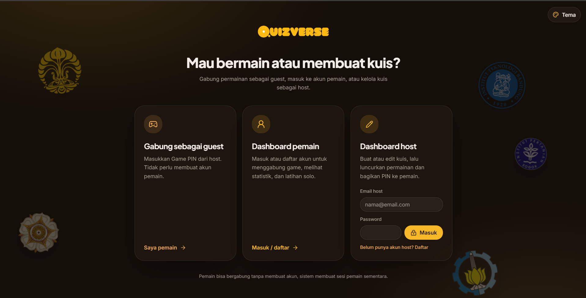

# Quizverse

### Quiz Nusantara Arena

Bikin kuis, ajak teman masuk lewat PIN, dan adu cepat menjawab. Mau latihan
sendiri dulu? Ada juga mode solo dengan statistik untuk akun pemain.

<p align="center">
  
</p>

<p align="center">
  
</p>

## Fitur

- **Main bareng:** host membuat kuis dan membagikan PIN; pemain bisa bergabung
  sebagai guest atau menggunakan akun.
- **Kuis buatan sendiri atau API:** host dapat menulis soal sendiri atau
  mengambil soal dari Open Trivia Database.
- **Buat soal dari materi:** unggah PPTX/PDF untuk membuat soal pilihan ganda
  dengan Gemini, lalu tinjau dan edit dulu sebelum ditambahkan ke kuis.
- **Permainan real-time:** lobby, soal, timer, skor, dan peringkat tersinkron
  untuk host dan pemain.
- **Latihan solo:** kerjakan soal OpenTDB dengan pilihan kategori, kesulitan,
  bahasa, dan batas waktu.
- **Akun pemain:** simpan statistik latihan solo dan statistik multiplayer.
- **Tampilan responsif:** pilihan tema Emas, Samudra, dan Hutan.

## Mulai di komputer lokal

**Yang dibutuhkan:** Node.js, npm, dan project Supabase.

```bash
git clone <url-repository>
cd <folder-repository>
npm ci
```

Salin `.env.example` menjadi `.env.local`, lalu isi kredensial Supabase dan API
key Gemini:

```env
VITE_SUPABASE_URL=https://your-project.supabase.co
VITE_SUPABASE_PUBLISHABLE_KEY=your-publishable-key
GEMINI_API_KEY=your-gemini-api-key
```

API key Gemini digunakan di server saja—jangan ubah namanya menjadi `VITE_*` atau
menaruhnya di kode frontend. Buat key melalui [Google AI Studio](https://aistudio.google.com/apikey).

Terapkan konfigurasi Supabase di bawah, lalu jalankan:

```bash
npm run dev
```

Buka alamat lokal yang ditampilkan Vite di terminal.

## Konfigurasi Supabase

Jalankan migration SQL berikut **berurutan** dari `supabase/migrations/`:

1. `20261101000000_kampusquiz_backend.sql`
2. `20261102180000_player_accounts_stats.sql`
3. `20261102191500_public_practice_quizzes.sql`
4. `20261102192000_practice_requires_account.sql`
5. `20261103021700_solo_practice_stats.sql`

Di Supabase Authentication:

- Aktifkan provider **Email** untuk akun host dan pemain.
- Aktifkan **Anonymous Sign-Ins** agar guest dapat bergabung ke game.
- Tambahkan URL `/player-dashboard` dan `/practice` pada **URL Configuration →
  Redirect URLs**, termasuk URL production dan lokal yang digunakan.

Kuis dan sesi multiplayer disimpan di Supabase. Row Level Security membatasi
akses data; skor pemain lain tidak ditampilkan kepada pemain.

## Deployment ke Vercel

Tambahkan `VITE_SUPABASE_URL` dan `VITE_SUPABASE_PUBLISHABLE_KEY` pada
**Project Settings → Environment Variables** untuk environment yang digunakan,
serta `GEMINI_API_KEY` sebagai environment variable server. Jangan gunakan prefix
`VITE_` untuk key Gemini. Kemudian deploy. Pastikan migration sudah diterapkan
dan pengaturan Authentication Supabase di atas sudah aktif.

## Membuat soal dari file

Di editor kuis, pilih **Buat soal dari file**, unggah PPTX atau PDF, pilih jumlah
soal dan fokus tambahan bila perlu, lalu buat soal. Hanya teks yang diekstrak di
browser yang dikirim ke Gemini; file maksimal 15 MB, 100 slide/halaman, dan
50.000 karakter. Gambar, diagram, atau halaman PDF hasil scan tidak dibaca.
Hasil AI perlu diperiksa karena kunci jawaban bisa saja keliru. Penggunaan Gemini
tunduk pada kuota dan ketentuan akun Google AI yang digunakan.

## Soal dan atribusi

Mode latihan solo dan sumber soal API multiplayer menggunakan
[Open Trivia Database](https://opentdb.com/). Soal OpenTDB berlisensi
[CC BY-SA 4.0](https://creativecommons.org/licenses/by-sa/4.0/) dan atribusinya
ditampilkan di aplikasi. Terjemahan bahasa Indonesia menggunakan layanan publik
MyMemory; bila layanan mencapai batas penggunaan, soal dapat tampil dalam bahasa
aslinya.

Logo kampus pada background dimuat dari Wikipedia Indonesia dan situs resmi IPB.
Logo digunakan sebagai elemen dekoratif; hak atas merek dan gambar tetap milik
pemegangnya.

## Perintah pengembangan

```bash
npm run dev       # Jalankan server lokal
npm run lint      # Periksa lint
npm test          # Jalankan test
npm run build     # Build production
```

---

<p align="center">Made by Himi · Quiz Nusantara Arena</p>
